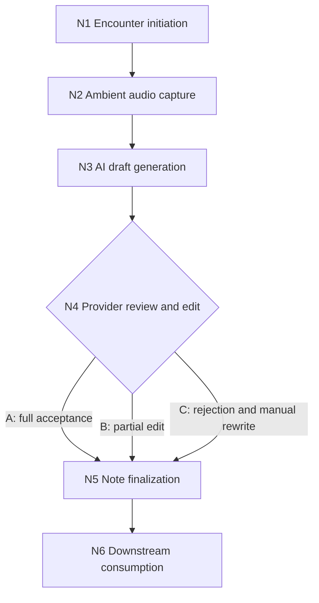

# Worked example: ambient AI documentation capture

A vendor-agnostic ambient scribe workflow, from the start of an encounter to the systems that read the signed note. Machine-readable annotation: [`pipeline.yaml`](pipeline.yaml).

Why this pipeline: the provider's review of the AI draft (N4) is the human-in-the-loop checkpoint in ambient documentation. It is where the AI's output becomes the clinician's note, and where the audit trail most often goes quiet.

## Node map



## Annotations

| Node | Required | Consumed | Produced |
|---|---|---|---|
| N1 Encounter initiation | patient and provider identity confirmed, consent status, tool activated | encounter record, consent status, tool config | `session_ID`, `capture_active_flag`, `consent_documented_flag`, `encounter_context_record` |
| N2 Audio capture | `session_ID`, `capture_active_flag`, audio stream | audio stream, encounter context | `audio_transcript_raw`, `session_duration`, `audio_quality_score` |
| N3 Draft generation | transcript, encounter context, `model_version_ID` | transcript, context, model version, problem list and prior notes (if pulled) | `draft_note`, `section_confidence_scores`, `model_version_ID`, `ehr_context_accessed_flag` |
| N4 Review and edit | `draft_note`, provider identity, `edit_interface_active` | draft, confidence scores | per branch: `acceptance_flag`, `edit_delta`, `manual_note_content`, `rejection_reason`, review time |
| N5 Finalization | `final_note_content`, `provider_signature`, `ehr_write_access` | final content, signature, encounter context | `signed_note_record`, `ehr_note_ID`, `finalization_metadata` |
| N6 Downstream use | `signed_note_record`, `ehr_note_ID` | signed note | billing codes, care team alerts, context for future encounters |

Full sets, including `F_available`, are in the YAML.

## Findings

```
$ python tools/fapm_check.py examples/ambient-documentation/pipeline.yaml
Ambient AI documentation capture: 7 finding(s)

  G1 missing-producer  N3     model_version_ID
  G1 missing-producer  N4     edit_interface_active
  G5 unstructured      N4/C   rejection_reason
  G1 missing-producer  N5     final_note_content
  G1 missing-producer  N5     ehr_write_access
  G4 provenance-gap    N5     rejection_reason
  G4 provenance-gap    N5     ehr_context_accessed_flag
```

Seven findings collapse into six distinct gaps. Four were identified in the original manual annotation pass. Two more surfaced when the same annotation was run through the checker.

### From the manual pass

**1. The model version has no producer (N3).** Draft generation requires `model_version_ID`, but nothing upstream produces it. It is a system parameter everyone assumes is there. If it is not captured in the session record at activation, the version that wrote a given note cannot be recovered later.
*Fix:* produce it at N1 when the tool is configured, or pull it explicitly at N3 and write it to the session record.

**2. Write access to the EHR is assumed, never checked (N5).** Finalization needs `ehr_write_access`. Nothing verifies it earlier, so a session timeout or credential change between encounter start and sign-off fails at the last step with no warning.
*Fix:* verify at N1 and carry it as a session-level feature.

**3. The reason for rejecting the draft is free text (N4, branch C → N5).** When a provider discards the AI draft, the reason is optional and unstructured, and it never reaches the provenance record. Monitoring sees `acceptance_flag = rejected` and nothing else. A factual error, an incomplete capture, a formatting problem and a clinical judgment override all look the same, yet each needs a different response.
*Fix:* a structured taxonomy, at minimum `{factual_error, incomplete_capture, formatting_issue, clinical_judgment_override, other}`, included in `finalization_metadata`.

**4. EHR context used during inference is not in the provenance record (N3 → N5).** The draft step records whether it pulled the problem list or prior notes, but that flag is never carried into the final record. The note cannot be traced to all of its inputs.
*Fix:* include `ehr_context_accessed_flag`, and which sources were accessed, in `finalization_metadata`.

### Surfaced by the checker

**5. The review interface is assumed to be up (N4).** `edit_interface_active` is required but has no declared source. It is the same class of gap as #2: system state taken for granted at the point of use.

**6. Nobody produces the note that gets signed (N5).** Finalization requires `final_note_content`, but no branch produces it. Branch A leaves the `draft_note`, branch B leaves an `edit_delta`, branch C leaves `manual_note_content`. The annotation never says how those become one note. That merge is exactly where an accepted draft and a partial edit could diverge from what the provider believes they signed.
*Fix:* make the merge explicit, either as a produced feature on each branch or as its own node between N4 and N5.

## Summary

| # | Gap | Where | Kind | Source |
|---|---|---|---|---|
| 1 | `model_version_ID` has no producer | N3 | Missing producer | Manual |
| 2 | `ehr_write_access` never verified | N5 | Missing producer | Manual |
| 3 | Rejection reason is free text and untracked | N4/C → N5 | Unstructured + provenance gap | Manual |
| 4 | EHR inference inputs not in provenance | N3 → N5 | Provenance gap | Manual |
| 5 | `edit_interface_active` assumed | N4 | Missing producer | Checker |
| 6 | No merge into `final_note_content` | N4 → N5 | Missing producer | Checker |

Gap 3 deserves the most attention. Post-deployment monitoring of an ambient scribe depends on knowing why clinicians override it. A pipeline that ships without structured override data cannot tell model failure from workflow failure later, no matter how good the dashboard is.

## Adapting this example

To annotate your own deployment, start from `pipeline.yaml` and answer:

| Element | Question |
|---|---|
| N1 consent | Is consent verbal, documented in the EHR, or opt-out? Where does `patient_consent_status` come from? |
| N3 context | Does your tool pull EHR context, or is it audio-only? Remove the optional pulls if so. |
| N4 branches | What counts as a partial edit versus a rejection in your clinicians' review culture? |
| N6 consumers | Which systems read the signed note: billing, care team, referrals, population health? |
| Gap 3 | Do your clinicians already have language for override reasons, or does the taxonomy need introducing? |
